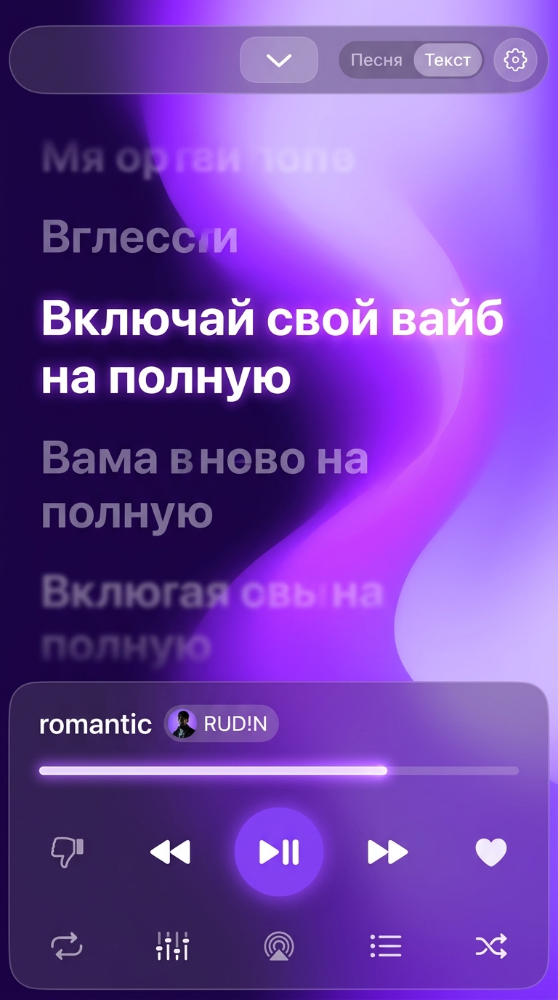
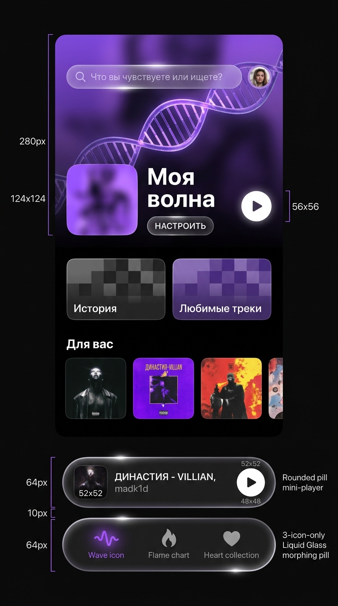

<div align="center">


# AmyMusic for iOS
**У вашей музыки есть цвет.**

*Современный нативный музыкальный плеер и стриминг-клиент для iOS с адаптивным Liquid Glass дизайном, синхронизированными текстами песен, умным импортом плейлистов и аудио в 320 kbps.*

[](https://apple.com)
[](https://swift.org)
[](https://developer.apple.com/xcode/swiftui/)
[](LICENSE)

[📦 **Скачать AmyMusic.ipa (Прямая загрузка)**](AmyMusic.ipa) &nbsp;&bull;&nbsp; [⚡️ Установка через Scarlet / TrollStore](#-установка-на-iphone) &nbsp;&bull;&nbsp; [🛠 Сборка из исходников](#-сборка-из-исходников)

---

</div>

<br/>

<div align="center">
  
  &nbsp;&nbsp;
  
</div>

<br/>

---

## 🌟 Ключевые возможности

### 🎨 Живой Liquid Glass интерфейс & Адаптивная палитра
- **Динамический анализ цвета**: В реальном времени извлекает доминантный оттенок, акценты и свечение из обложки текущего трека (`DynamicColorExtractor`).
- **Свечение и глубина**: Многослойный полупрозрачный блюр (`UltraThinMaterial`), интерактивные бегунковые элементы и эффекты перелива.
- **6 авторских тем оформления**:
  - `Amy Classic` (глубокий фирменный фиолетовый градиент)
  - `Deep AMOLED` (идеальный чёрный для сохранения энергии OLED)
  - `Cyberpunk Neon` (кислотно-зелёный и неоновый розовый)
  - `Lavender Dream` (пастельные мягкие тона)
  - `Crimson Sunset` (тёплый рубиновый закат)
  - `Emerald Forest` (глубокий благородный изумруд)

### 🎵 Мульти-источники и аудиофильское воспроизведение
- **SoundCloud API v2**: Стриминг треков, плейлистов, альбомов и чартов в качестве до **320 kbps**.
- **Яндекс.Музыка & Чарты**: Поиск, рекомендации, тренды и артисты.
- **Двухдвижковый AVPlayer с Crossfade**: Плавное сведение треков с настраиваемым временем (от 1 до 12 секунд) без пауз и щелчков (`Dual AVPlayer Engine`).
- **Gapless Playback**: Мгновенный переход между треками без задержек.
- **Кэширование фрагментов**: Быстрый запуск воспроизведения благодаря предзагрузке аудио-сегментов.

### ⚡️ Продвинутый импорт из Spotify без ограничений
- **Spotify Web API (PKCE OAuth2)**: Встроенный безопасный вход в аккаунт Spotify с поддержкой кастомного Client ID прямо в приложении.
- **Перенос 500+ треков за один тап**: Устранено ограничение Spotify в 100 треков — автоматическая постраничная загрузка (`nextUrl` chaining) с повторными попытками при сетевых сбоях.
- **Умное связывание (SoundCloud Bridge)**: Каждый перенесённый трек сохраняет оригинальную HD-обложку Spotify, исполнителей и метаданные, моментально связываясь с аудиопотоком 320 kbps на SoundCloud.
- **Кнопка «Обновить»**: Если плейлист в коллекции устарел или пополнился новыми треками, 1-тап кнопка «Обновить (501)» актуализирует весь список.
- **Импорт по ссылке**: Вставка любой публичной ссылки (`spotify.com/playlist/...`, `spotify.com/album/...`, `spotify.com/track/...`, а также SoundCloud и Яндекс).

### 🌊 Персональная «Моя Волна» (Wave DNA)
- Алгоритмический подбор бесконечного потока музыки на базе ваших лайков, истории воспроизведения и выбранных семян настроения.
- **Интерактивный спектральный визуализатор**: Анимированная волна ДНК, пульсирующая в такт воспроизведению.
- Фильтры настроения: *Энергичное*, *Спокойное*, *Тёмное*, *Любимое*, *Незнакомое*.

### 📝 Синхронизированные слова (Karaoke & Synced Lyrics)
- Автоматический поиск синхронизированных `.lrc` текстов песен через **LRCLIB**, **Genius** и **NetEase**.
- **Построчная и пословная подсветка** с кинетической плавной прокруткой и размытием неактивных строк.
- Быстрый переход к любой секунде трека простым тапом по строке текста.
- Возможность копирования и расшаривания любимых цитат.

### 🎚 Профессиональный 10-полосный эквалайзер
- Параметрический эквалайзер CoreAudio: 32 Hz, 64 Hz, 125 Hz, 250 Hz, 500 Hz, 1 kHz, 2 kHz, 4 kHz, 8 kHz, 16 kHz.
- Готовые пресеты: *Flat*, *Bass Boost*, *Treble Boost*, *Vocal*, *Electronic*, *Rock*, *Hip-Hop*, *Acoustic*, *R&B*.
- Сохранение пользовательских профилей звучания.

### 📱 Интеграция с iOS и экраном блокировки
- **Now Playing**: Полноценная поддержка Control Center и Lock Screen с высоким разрешением обложек и перемоткой.
- **Поддержка гарнитур и кнопок**: Пауза/плей/перемотка с наушников AirPods / EarPods, Bluetooth-колонок и CarPlay.
- **Коллекция и оффлайн-кэш**: Сохранение любимых треков, альбомов и пользовательских плейлистов с мгновенным доступом без сети.

### 🛡 Встроенный Smart Proxy Manager
- Встроенная поддержка проксирования для стабильной работы SoundCloud и Spotify без необходимости постоянного включения системного VPN.

---

## 📲 Установка на iPhone

Готовый файл приложения **`AmyMusic.ipa`** находится прямо в этом репозитории.

### Способ 1: Scarlet / TrollStore / AltStore / SideStore (Без ПК или через ПК)
1. Скачайте файл [**`AmyMusic.ipa`**](AmyMusic.ipa) из репозитория на iPhone.
2. Откройте ваш установщик (Scarlet, TrollStore, AltStore, SideStore или Esign).
3. Выберите скачанный `.ipa` и подтвердите установку.
4. Откройте AmyMusic и наслаждайтесь любимой музыкой!

### Способ 2: Sideloadly (Windows / macOS)
1. Подключите iPhone к компьютеру кабелем или по Wi-Fi.
2. Перетащите файл `AmyMusic.ipa` в окно Sideloadly.
3. Введите свой Apple ID и нажмите **Start**.

---

## 🛠 Сборка из исходников

### Требования
- Mac с установленным **macOS Sonoma (14.0+)** или **Sequoia (15.0+)**
- **Xcode 16.0+** (поддержка Swift 6)
- Устройство с **iOS 17.0+** или симулятор iOS

### Шаги для сборки:
```bash
# 1. Клонируйте репозиторий
git clone https://github.com/sergetik52/amymusic-ios.git
cd amymusic-ios

# 2. Откройте проект в Xcode
open AmyMusic.xcodeproj
```

В Xcode:
1. Выберите таргет **AmyMusic**.
2. Во вкладке **Signing & Capabilities** укажите вашу команду разработчика (**Team**).
3. Выберите подключенный iPhone или симулятор.
4. Нажмите **Cmd + R** (Run) для сборки и запуска на устройстве.

---

## 📁 Структура проекта

```text
amymusic-ios/
├── AmyMusic/
│   ├── App/
│   │   └── AmyMusicApp.swift          # Точка входа в приложение
│   ├── Audio/
│   │   ├── AudioPlayerManager.swift    # Главный контроллер аудио, стейт и очередь
│   │   └── EqualizerEngine.swift       # 10-полосный эквалайзер CoreAudio
│   ├── Models/
│   │   └── Models.swift                # Модели Track, ReleaseItem, ArtistRef, Palette, Settings
│   ├── Services/
│   │   ├── SoundCloudService.swift     # API SoundCloud v2 (поиск, стримы, тренды)
│   │   ├── SpotifyService.swift        # Spotify Web API, PKCE OAuth2, умная пагинация
│   │   ├── YandexMusicService.swift    # Чарты и рекомендации Яндекс.Музыки
│   │   ├── LyricsService.swift         # Синхронизированные слова (LRCLIB, Genius)
│   │   ├── ReleaseCacheManager.swift   # Дисковый и оперативный кэш релизов
│   │   └── SoundCloudProxyManager.swift# Умный маршрутизатор и пул прокси
│   └── Views/
│       ├── MainTabView.swift           # Навигация (Волна, Главная, Поиск, Коллекция, Настройки)
│       ├── FullPlayerOverlay.swift     # Полноэкранный плеер с жестами и винилом
│       ├── WaveView.swift              # Персональная Волна и ДНК-визуализатор
│       ├── SyncedLyricsView.swift      # Караоке-тексты песен с живой анимацией
│       ├── CollectionView.swift        # Коллекция, плейлисты, модалка импорта
│       ├── ArtistAndAlbumView.swift    # Экран альбома, плейлиста и карточка артиста
│       └── SettingsAndProfileView.swift# Настройки темы, эквалайзер, прокси, Spotify
├── AmyMusicWidget/                     # Live Activities & Dynamic Island виджет
├── design-preview/                     # Скриншоты и макеты интерфейса
├── AmyMusic.ipa                        # Готовая подписанная сборка для установки
└── README.md                           # Документация проекта
```

---

## 📄 Лицензия

Проект распространяется под лицензией **MIT**. Подробности в файле [LICENSE](LICENSE).

<br/>

<div align="center">
  <sub>Создано с любовью к музыке и качественному звуку. AmyMusic © 2026</sub>
</div>
